# C2Java

C2Java is an agentic migration pipeline that converts a **C project directory**
into a **Java 17 Maven project**. It parses C source and headers, builds
dependency-aware documentation, plans the Java design, generates Java code,
optionally refines it against requirements and translated tests, and copies the
selected repository to a final output directory.

The installed command is still named `rustprint` because this codebase evolved
from an earlier project. The active translation implementation is C to Java.

## Get the handoff branch

```bash
git clone --branch feat/docker-demo --single-branch \
  https://github.com/anhnd1/c2java.git
cd c2java
```

`dummy_c_project/` is included and is enough for the first end-to-end run. The
`libcbor`, `libyaml`, and `stb` fixtures are Git submodules; initialize them only
when those larger inputs are needed:

```bash
git submodule update --init --recursive
```

## Demo UI team: read this first

### Can a user upload C files and download a Java ZIP today?

**Not through the current HTTP server.** The current web UI is a local pipeline
tracker and configuration form:

- Input is an **existing project directory on the backend/container filesystem**.
- `POST /api/start` receives JSON containing `config.source.path`.
- Output is a **Java/Maven directory on the backend/container filesystem**.
- Completion state contains `final_path`, not a downloadable file.
- There is currently no multipart upload endpoint, ZIP builder, download
  endpoint, job ID, job history, or concurrent job manager.

For a browser demo, the recommended integration is:

1. Accept a project ZIP, a folder upload, or one `.c` file plus optional headers.
2. Materialize the upload as a project directory in an isolated job workspace.
3. Pass that directory to the existing `MigrationRunner` as `source.path`.
4. Stream pipeline state and logs to the browser.
5. After completion, independently validate the Maven project.
6. Package the final project as `<project>-java.zip` and expose a download URL.

The upload/job/download layer described below is the recommended contract for
the demo UI. It is **a design target and is not implemented in this repository**.

## Pipeline diagram

```mermaid
flowchart LR
    U["Browser input<br/>project.zip / folder / C files<br/><i>proposed UI adapter</i>"]
    X["Extract into isolated<br/>job project directory<br/><i>proposed</i>"]
    L["Current input<br/><code>source.path</code><br/>existing directory"]

    S["C project<br/><code>.c + .h</code><br/>optional tests"]
    A["Analyze<br/>AST + call/dependency graph"]
    D["Document<br/>modules + architecture"]
    P["Plan<br/>Java design"]
    G["Generate<br/>Java 17 + Maven"]
    R["Requirement refinement<br/><i>optional</i>"]
    T["Translate and run tests<br/><i>optional</i>"]
    F["Finalize<br/>selected Java repository"]
    O["Current output<br/>filesystem directory"]
    Z["Download<br/><code>&lt;project&gt;-java.zip</code><br/><i>proposed UI adapter</i>"]

    U -.-> X
    X -.-> S
    L --> S
    S --> A --> D --> P --> G --> R --> T --> F --> O
    O -.-> Z

    classDef boundary fill:#dbeafe,stroke:#2563eb,color:#172554
    classDef agent fill:#f3e8ff,stroke:#9333ea,color:#3b0764
    classDef output fill:#dcfce7,stroke:#16a34a,color:#052e16
    class U,X,L,S boundary
    class A,D,P,G,R,T agent
    class F,O,Z output
```



For the included `dummy_c_project`, the visible transformation is:

| C input | Generated Java output |
| --- | --- |
| `struct Point { int x; int y; }` | `record Point(int x, int y)` |
| `add_points(Point, Point)` | `Geometry.addPoints(Point, Point)` |
| C directory with headers, source, and tests | Java 17 Maven repository |

## Core input contract

### Input unit

The core pipeline accepts **one directory representing one C project**. It does
not accept raw file bytes, a ZIP stream, or an individual file path.

The project name is derived from the directory basename:

```text
/jobs/01/input/geometry-lib
               └────────── project name = geometry-lib
```

The source directory must contain at least one lowercase `.c` or `.h` file
recursively. A useful input normally preserves all source-relative paths so that
header layout and module ownership remain understandable.

Recommended input layout:

```text
geometry-lib/
├── include/
│   └── geometry.h
├── src/
│   └── geometry.c
├── tests/                       # optional; must be test/ or tests/ at root
│   └── test_geometry.c
├── CMakeLists.txt               # optional context
├── Makefile                     # optional context
└── README.md                    # optional context
```

Input behavior:

| Input | Current behavior |
| --- | --- |
| Directory containing `.c` or `.h` | Accepted |
| Directory with nested source folders | Accepted; hierarchy is preserved |
| Root `test/` or `tests/` directory | Enables optional test translation |
| One `.c` file path | Rejected because `source.path` must be a directory |
| One `.c` file wrapped in a directory | Accepted; headers should be included if referenced |
| ZIP file path or uploaded ZIP bytes | Not accepted by the core runner |
| Directory with no lowercase `.c`/`.h` | Rejected before migration starts |

For a browser UI, a single-file upload can be supported by creating a directory
such as `/jobs/<job-id>/input/<project-name>/`, writing the uploaded file into
it, and then starting the core runner with that directory. A ZIP or folder upload
is preferable because real C projects rely on headers and relative paths.

### Runtime configuration input

The runner receives a configuration object with this shape:

```json
{
  "model": {
    "name": "gpt-5.4",
    "provider": "openai"
  },
  "source": {
    "path": "/work/source/dummy_c_project"
  },
  "api": {
    "api_key": "",
    "base_url": "https://api.openai.com/v1"
  },
  "output": {
    "base_dir": "/root/rustprint-output",
    "cache": "/root/.cache/rustprint"
  },
  "git": {
    "branch_enabled": false,
    "branch_name": "rustprint-migration",
    "commit": false
  },
  "requirement_refinement": {
    "enabled": false,
    "rounds": 2
  },
  "execution_refinement": {
    "enabled": false,
    "rounds": 2,
    "translate_tests": false
  },
  "run": {
    "force": false
  }
}
```

For Docker, `source.path` must be the **container path**, such as
`/work/source/dummy_c_project`, not the corresponding host path.

### Model input

The endpoint must implement an OpenAI-compatible chat-completions API with tool
calling. This matters because translation agents write files and invoke Maven
through tools; a text-only endpoint cannot complete the pipeline.

Environment variables override project configuration:

```text
LLM_API_KEY       required credential
LLM_BASE_URL      OpenAI-compatible base URL
MODEL             main model name
LLM_MAX_RETRIES   provider retry budget
```

## Core output contract

### Final output

The current output is a directory, not an archive:

```text
<output-base>/<project-name>/
├── pom.xml
├── README.md
├── .gitignore
├── src/
│   ├── main/
│   │   └── java/
│   │       └── <generated packages>/*.java
│   └── test/
│       └── java/                # optional when tests were translated
├── target/                      # may exist if Maven was run
├── result.json                  # optional execution summary
├── execution.jsonl             # optional per-test records
└── temp.log                    # optional Maven execution log
```

In the Docker setup:

| Purpose | Container path | Host path |
| --- | --- | --- |
| Final Java project | `/root/rustprint-output/<project>` | `.docker-data/output/<project>` |
| Intermediate cache | `/root/.cache/rustprint/<project>` | `.docker-data/cache/<project>` |
| Project configuration | `/root/.config/rustprint/<project>` | `.docker-data/config/<project>` |

The path returned in `state.final_path` is the container/backend path. A remote
browser cannot open it directly; the UI backend must turn it into artifact and
download URLs.

### Recommended downloadable ZIP

The demo UI should package only the deliverable repository by default:

```text
geometry-lib-java.zip
└── geometry-lib/
    ├── pom.xml
    ├── README.md
    └── src/
        ├── main/java/**/*.java
        └── test/java/**/*.java  # when available
```

Recommended packaging rules:

- Preserve one top-level project directory in the ZIP.
- Include `pom.xml`, generated documentation, and Java sources.
- Include translated tests when present.
- Exclude internal cache versions, credentials, and temporary LLM logs.
- Exclude `target/` by default so the archive contains reproducible source,
  rather than stale compiled classes.
- Optionally expose a separate debug-artifacts ZIP containing generated C docs,
  evaluation results, and execution logs.
- Create the ZIP only after finalization and an independent Maven validation.

## Detailed pipeline stages and artifacts

### 1. Source preparation — deterministic

**Input:** configured source project directory.

The runner validates that the path is a directory and contains `.c` or `.h`
files. It then creates a source workspace using a symlink when possible and a
full copy otherwise.

**Output:**

```text
<cache>/<project>/source_repos/<project>/
```

This staging directory becomes the stable source location used by later phases.

### 2. C analysis and documentation — parser plus documentation agents

**Inputs:** staged C project, model configuration.

Work performed:

1. Parse `.c` and `.h` files with Tree-sitter.
2. Identify functions and function calls.
3. Build dependency and top-file metadata.
4. Cluster related files into modules.
5. Run documentation agents for the modules and repository overview.

**Outputs:**

```text
<cache>/<project>/c_docs/version_0/
├── metadata.json
├── <project>/docs/
│   ├── overview.md
│   ├── module_tree.json
│   ├── first_module_tree.json
│   ├── metadata.json
│   └── <module documentation>.md     # when multiple modules exist
└── temp/
    ├── dependency_graphs/<project>_dependency_graph.json
    └── top_files/<project>_top_files.json
```

**UI stage ID:** `docs`, displayed as **C Documentation**.

### 3. Initial C-to-Java translation — planner, implementation, synthesis agents

**Inputs:** C source, dependency information, generated C documentation, module
tree, model and tool configuration.

Agent orchestration:

1. **Planner agent** reads relevant C components and documentation and decides
   the Java package, types, methods, and implementation order.
2. **Implementation agent** creates a Java 17 Maven skeleton, writes Java source,
   and can call the Maven compiler for feedback.
3. **Synthesis agent** combines generated features into the root Maven project
   and produces project-level files such as `pom.xml` and `README.md`.

**Output:**

```text
<cache>/<project>/translated_repos/version_0/<project>/
├── pom.xml
├── README.md
└── src/main/java/**/*.java
```

**UI stage ID:** `translate`, displayed as **Translation**. Live child states can
include the current feature plus `Planner`, `Skeleton`, and `Synthesis` phases.

### 4. Requirement refinement — optional agent/evaluator loop

Enabled by `requirement_refinement.enabled`.

For each round `N`:

1. Generate documentation from Java version `N`.
2. Compare the Java documentation with the C documentation using generated
   rubrics.
3. Ask a refinement agent to modify deficiencies into version `N + 1`.
4. After all rounds, evaluate candidates and copy the selected repository to
   `best_solution`.

**Inputs:** translated Java version, C documentation, model.

**Outputs:**

```text
<cache>/<project>/
├── sketch_docs/version_N/<project>/
│   ├── docs/*.md
│   └── evaluation_results/*
├── translated_repos/version_N/<project>/
├── translated_repos/version_N+1/<project>/
└── translated_repos/best_solution/<project>/
```

When this phase is disabled, `version_0` is copied directly to `best_solution`.

**UI stage ID:** `requirement`, with per-round documentation, refinement, final
evaluation, and best-solution-selection children.

### 5. Source-test translation — optional test agent

This stage runs only when all of the following are true:

- `execution_refinement.enabled` is true.
- `execution_refinement.translate_tests` is true.
- The source project has a root `test/` or `tests/` directory.

**Inputs:** original C tests and the selected Java repository.

The test agent translates relevant C test behavior into JUnit tests under
`src/test/java`.

**Output:**

```text
<cache>/<project>/translated_repos/execution-aware/version_0/<project>/
└── src/test/java/**/*.java
```

**UI stage ID:** `test_trans`, displayed as **Test Translation**.

### 6. Maven execution and repair — optional deterministic/agent loop

For each execution round:

1. Run `mvn test` against the current execution-aware repository.
2. Parse Maven Surefire XML into structured test records.
3. Ask an execution-refinement agent to repair failing behavior.
4. Write the next execution-aware version.
5. Run a final Maven test pass after the configured rounds.

**Inputs:** Java project, translated JUnit tests, Maven.

**Possible outputs:**

```text
<cache>/<project>/translated_repos/execution-aware/version_N/<project>/
├── src/main/java/**/*.java
├── src/test/java/**/*.java
├── target/surefire-reports/*
├── temp.log
├── execution.jsonl
└── result.json
```

**UI stage ID:** `execution`, with one child per execution round.

### 7. Finalization — deterministic copy

The runner selects the latest execution-aware repository when execution was
used; otherwise it selects `best_solution`. It then replaces the configured
final destination and copies the chosen repository into it.

**Input:** selected cached Java repository.

**Output:**

```text
<output-base>/<project>/
```

**UI stage ID:** `finalize`. On completion, `state.final_path` contains the
backend path of the final repository.

### 8. ZIP packaging — proposed UI adapter, not implemented

**Input:** `state.final_path` after independent validation.

The demo backend should copy/package the deliverable files, create
`<project>-java.zip`, record its metadata against the job, and expose it through
an HTTP download response.

**Output:** downloadable `application/zip` response.

## Current web API

The bundled server owns one singleton `MigrationRunner`, so it supports one
in-process migration at a time.

| Method | Route | Current purpose |
| --- | --- | --- |
| `GET` | `/` | Serve the bundled local tracker |
| `GET` | `/api/config` | Return the current directory's saved/default configuration |
| `GET` | `/api/state` | Return current state plus recent logs |
| `GET` | `/api/events` | Stream state/log/error/done events using SSE |
| `POST` | `/api/start` | Start using a JSON config and existing source directory |
| `POST` | `/api/stop` | Request cancellation after the current stage |
| `POST` | `/api/open` | Open a backend-local path in an editor/file explorer |

`/api/open` is useful only for a local developer tracker and should not be part
of a remote demo UI contract.

### Current start request

```http
POST /api/start
Content-Type: application/json

{
  "config": {
    "source": {"path": "/work/source/dummy_c_project"},
    "model": {"name": "gpt-5.4", "provider": "openai"},
    "api": {"api_key": "", "base_url": "https://api.openai.com/v1"},
    "output": {
      "base_dir": "/root/rustprint-output",
      "cache": "/root/.cache/rustprint"
    },
    "requirement_refinement": {"enabled": false, "rounds": 2},
    "execution_refinement": {
      "enabled": false,
      "rounds": 2,
      "translate_tests": false
    },
    "run": {"force": false}
  }
}
```

Success response:

```json
{"status": "success", "message": "Migration started"}
```

There is no job ID in the current response.

### Current state response

```json
{
  "running": true,
  "error": null,
  "final_path": null,
  "stages": [
    {
      "id": "docs",
      "label": "C Documentation",
      "status": "done",
      "detail": "",
      "path": "/root/.cache/rustprint/dummy_c_project/c_docs/version_0/dummy_c_project"
    },
    {
      "id": "translate",
      "label": "Translation",
      "status": "active",
      "detail": "",
      "children": []
    }
  ],
  "logs": []
}
```

Stage statuses are `pending`, `active`, `done`, `skipped`, or `error`.

### Current SSE events

Connect with:

```javascript
const events = new EventSource("/api/events");

events.onmessage = ({ data }) => {
  const event = JSON.parse(data);
  if (event.type === "state") renderPipeline(event);
  if (event.type === "log") appendLog(event);
  if (event.type === "error") showError(event.message);
  if (event.type === "done") finishRun(event.final_path, event.error);
};
```

Example log event:

```json
{
  "type": "log",
  "level": "info",
  "message": "Translation completed in 2m 14s",
  "ts": 1787241000.0
}
```

## Proposed demo UI API

This layer should wrap, rather than replace, `MigrationRunner`.

### Recommended endpoints

| Method | Proposed route | Purpose |
| --- | --- | --- |
| `POST` | `/api/v1/jobs` | Upload source and create/start a job |
| `GET` | `/api/v1/jobs/{job_id}` | Read job status and artifact links |
| `GET` | `/api/v1/jobs/{job_id}/events` | Stream job-scoped SSE events |
| `POST` | `/api/v1/jobs/{job_id}/cancel` | Request cancellation |
| `GET` | `/api/v1/jobs/{job_id}/artifacts` | List final and diagnostic artifacts |
| `GET` | `/api/v1/jobs/{job_id}/download` | Download final Java project ZIP |

### Proposed upload request

```http
POST /api/v1/jobs
Content-Type: multipart/form-data

source=@geometry-lib.zip
project_name=geometry-lib
options={
  "requirement_refinement": {"enabled": false, "rounds": 2},
  "execution_refinement": {
    "enabled": true,
    "rounds": 2,
    "translate_tests": true
  }
}
```

For a first demo, support ZIP as the canonical input. Folder upload or
`files[]` can be normalized into the same internal directory structure. A lone
`.c` file can be wrapped into a generated project directory.

### Proposed create response

```http
HTTP/1.1 202 Accepted
Content-Type: application/json

{
  "job_id": "job_01JABC123",
  "project_name": "geometry-lib",
  "status": "queued",
  "status_url": "/api/v1/jobs/job_01JABC123",
  "events_url": "/api/v1/jobs/job_01JABC123/events",
  "artifacts_url": "/api/v1/jobs/job_01JABC123/artifacts",
  "download_url": null
}
```

### Proposed job lifecycle

```text
queued
  └── running
       ├── completed ──> download available
       ├── failed
       └── cancel_requested ──> cancelled
```

Recommended status response after completion:

```json
{
  "job_id": "job_01JABC123",
  "project_name": "geometry-lib",
  "status": "completed",
  "stage": "finalize",
  "validation": {
    "compile": "passed",
    "tests": "passed",
    "test_count": 12
  },
  "artifacts": [
    {
      "name": "geometry-lib-java.zip",
      "kind": "final_project",
      "download_url": "/api/v1/jobs/job_01JABC123/download"
    }
  ]
}
```

Only claim `tests: passed` when tests actually exist and an independent clean
Maven command succeeded. Otherwise distinguish `compile: passed` from
`tests: not_available`.

### Proposed adapter workflow

1. Generate a unique `job_id`.
2. Save the uploaded archive outside the source directory.
3. Extract while preserving relative source/header/test paths.
4. Reject archives without `.c` or `.h` files.
5. Normalize the extracted root to `/jobs/<job-id>/input/<project-name>`.
6. Give the job unique cache and output paths to avoid basename collisions.
7. For a simple demo, queue jobs and run one at a time. For concurrent jobs,
   launch a separate worker process/container per job; the core updates process
   environment and logging state and should not be treated as multi-tenant
   within one Python process.
8. Map core state events to the job-scoped SSE endpoint.
9. When `final_path` is available, run a clean independent Maven validation.
10. Produce the final ZIP and publish its download URL.
11. Retain or expire job inputs, cache, logs, and artifacts according to the
    demo environment's lifecycle policy.

Each worker should also receive job-specific cache, output, configuration, and
home directories. This prevents two uploads with the same project basename from
sharing config or cached translation state.

Upload extraction should enforce deployment-specific limits for archive size,
expanded size, file count, and path validity before starting an expensive job.

## Running with Docker

### Requirements

- Docker with Linux-container support
- An OpenAI-compatible tool-calling model endpoint
- An API key for that endpoint

The container includes Ubuntu 24.04, Python 3.12, JDK 17, Maven, Node, `find`,
and `grep`.

### Configure

```bash
cp .env.example .env
```

Set at least:

```dotenv
LLM_API_KEY=replace-me
LLM_BASE_URL=https://api.openai.com/v1
MODEL=gpt-5.4

C_SOURCE_DIR=./dummy_c_project
C_PROJECT_NAME=dummy_c_project

REQUIREMENT_REFINEMENT=false
EXECUTION_REFINEMENT=false
TRANSLATE_TESTS=false
```

For another source repository:

```dotenv
C_SOURCE_DIR=C:/path/to/my-c-project
C_PROJECT_NAME=my-c-project
```

`C_PROJECT_NAME` must match the intended source project directory name.

### Build and run

```bash
docker compose build

docker compose run --rm c2java \
  /workspace/c2java/docker/write-config.sh

docker compose run --rm c2java \
  rustprint migrate --no-web
```

Validate independently:

```bash
docker compose run --rm c2java bash \
  /workspace/c2java/docker/validate-output.sh
```

### Run the bundled tracker

```bash
docker compose run --rm --service-ports c2java \
  rustprint migrate --host 0.0.0.0 --port 5000
```

Open `http://127.0.0.1:5000`.

The tracker must receive `/work/source/<project>` as the source path because
that is where Compose mounts the host project inside the container.

## Presentation demo

After one successful `dummy_c_project` migration, run from PowerShell:

```powershell
.\demo.ps1 -Pause
```

The presentation shows:

1. Original C header and implementation.
2. Generated architecture documentation.
3. Generated Java `Point` record and `Geometry.addPoints` method.
4. A clean Maven compilation.
5. Behavioral checks matching the original C assertions.

The presentation reuses saved artifacts and does not make LLM requests.

## Native CLI usage

Requirements:

- Python 3.12+
- Java 17+
- Maven 3.8+
- Node.js 14+

Install:

```bash
python3 -m venv .venv
source .venv/bin/activate
python -m pip install --upgrade pip
python -m pip install -e ".[dev]"
```

Configure and run from the C project's directory:

```bash
rustprint init /absolute/path/to/my-c-project
cd /absolute/path/to/my-c-project
rustprint migrate
```

Useful commands:

```bash
rustprint migrate --no-web
rustprint migrate --force
rustprint config show
rustprint config set requirement_refinement.enabled false
rustprint config set execution_refinement.enabled false
```

## Integration limitations to account for

- The current HTTP server accepts a backend-local directory, not uploads.
- The current output is a backend-local directory, not a ZIP or HTTP artifact.
- The current server has one singleton runner and no job IDs or job history.
- Cancellation is cooperative and takes effect between major stages.
- Source test discovery only checks root `test/` and `tests/` directories.
- Requirement and execution refinement are optional and can greatly increase
  runtime and model usage.
- A pipeline completion message is not sufficient evidence of correctness.
  Validate the final project independently with a clean Maven invocation.
- A successful compile with zero discovered tests must be displayed differently
  from a successful test run.
- Cached translation directories can cause stages to be reused. Job-based UI
  execution should use unique workspaces rather than sharing cache by project
  basename.
- Generated Java requires human review for C pointer ownership, macros,
  platform-specific behavior, undefined behavior, and native integration.

## Repository layout

```text
rustprint/
├── cli/                         CLI, configuration, pipeline wrappers
├── web/                         Current local tracker and SSE server
└── src/
    ├── dependency_analyzer/     Tree-sitter and dependency analysis
    ├── documentation/           Documentation/refinement agents
    ├── translation/             Java generation, test translation, repair
    └── agent_tools/             Agent file/search/Maven tools

docker/                          Container setup and validation helpers
codewikibench/                   Requirement-document evaluation tooling
dummy_c_project/                 Small end-to-end C demo input
libcbor_output/                  Checked-in Java/Maven example
tests/                           Python tests for migration utilities
Dockerfile                       Ubuntu agent environment
compose.yaml                     Source/cache/output container mounts
DEMO.md                          Operator runbook and presentation notes
demo.ps1                         One-command saved-artifact demo
```

## Development checks

```bash
python -m pip install -e ".[dev]"
pytest
mvn -f libcbor_output/pom.xml test
```

## License and provenance

This project is released under the MIT License. See [LICENSE](LICENSE). This
fork preserves the original repository history and attribution.
