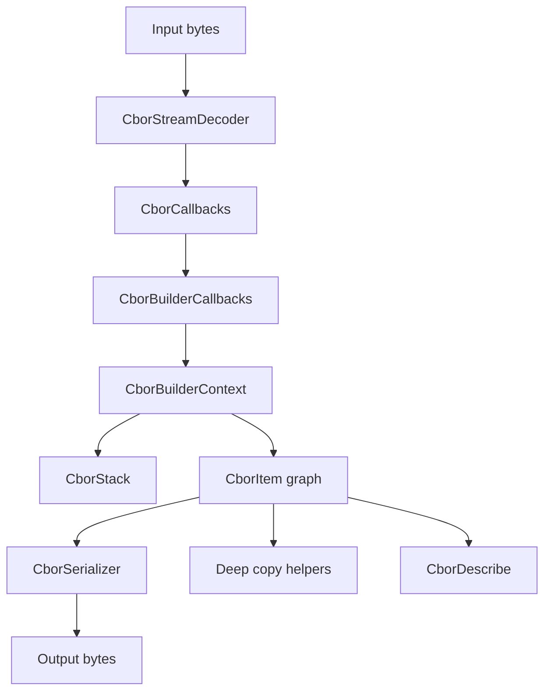

# libcbor Java Translation Implementation Plan

## 1. Overview

### Module purpose
`libcbor` is a CBOR runtime for parsing, building, serializing, copying, and inspecting CBOR data items. The translated Java module should preserve the same core capabilities: streaming decode, tree construction, serialization, deep copy / structural comparison, allocator customization, and debug description.

### Translation approach
- Model CBOR items as a typed Java object graph rather than C-style tagged structs with manual refcounting.
- Keep parser, builder, serializer, and utility logic separated into cohesive classes.
- Preserve CBOR wire semantics exactly, including definite vs. indefinite containers, chunked strings/bytestrings, tag nesting, and numeric width-sensitive encoding.
- Replace C error codes with Java exceptions for programmer errors and checked/unchecked result objects for recoverable decode/serialization outcomes where needed.
- Use only Java 17+ and the standard library.

### Inferred base package
Use `com.migration.generated.libcbor` as the stable base package. All Java sources must live under `src/main/java/com/migration/generated/libcbor/...`.

## 2. Maven and Directory Structure

### `pom.xml`
- Set `maven.compiler.source` and `maven.compiler.target` to `17`.
- Package as a standard Maven jar.
- No production dependencies.
- Enable UTF-8 source encoding and reproducible builds where practical.

### Directory layout
- `src/main/java/com/migration/generated/libcbor/`
- `src/main/java/com/migration/generated/libcbor/model/`
- `src/main/java/com/migration/generated/libcbor/encoding/`
- `src/main/java/com/migration/generated/libcbor/decoding/`
- `src/main/java/com/migration/generated/libcbor/internal/`
- `src/main/java/com/migration/generated/libcbor/util/`

### Proposed top-level files
- `Cbor.java` for public facade methods.
- `CborItem.java` and specialized item classes/records.
- `CborType.java`, `CborWidth.java`, `CborDecoderStatus.java`.
- `CborCallbacks.java` and default no-op callback implementation.
- `CborStreamDecoder.java` for streaming decode.
- `CborSerializer.java` for size calculation and byte emission.
- `CborLoader.java` or `CborReader.java` for load composition.
- `CborDescribe.java` for debug description.

## 3. Detailed Component Specifications

### `src/main/java/com/migration/generated/libcbor/model/CborItem.java`
- Base abstraction for all CBOR values.
- Hold common behavior: type, structural equality, encoded size, serialization dispatch, and optional tag / container accessors.
- Use an abstract `class`, not a `record`, because most CBOR values have behavior and mutable child relationships during construction.

### `src/main/java/com/migration/generated/libcbor/model/CborType.java`
- Enum for CBOR major categories: unsigned int, negative int, byte string, text string, array, map, tag, float/control.
- Corresponds to `cbor_typeof` and `cbor_isa_*` predicates.

### `src/main/java/com/migration/generated/libcbor/model/CborWidth.java`
- Enum for integer width and float/control width variants.
- Preserve width as part of structural identity for integers and floating/control values.

### `src/main/java/com/migration/generated/libcbor/model/CborUnsignedInteger.java`
- Represents major type 0.
- Store the raw magnitude and width chosen for encoding.
- Mutable only if translation needs setter-style APIs; otherwise keep immutable and build via factory methods.

### `src/main/java/com/migration/generated/libcbor/model/CborNegativeInteger.java`
- Represents major type 1.
- Store the CBOR encoded magnitude (the non-negative representation used on the wire) and width.
- Provide value conversion helpers for signed semantics.

### `src/main/java/com/migration/generated/libcbor/model/CborByteString.java`
- Represents definite or indefinite byte strings.
- If definite, store `byte[]` payload and length.
- If indefinite, store `List<CborByteStringChunk>` or `List<CborByteString>` chunks.
- Use a regular `class`, not a `record`, because the C module supports incremental chunk addition and ownership transfer during build.

### `src/main/java/com/migration/generated/libcbor/model/CborTextString.java`
- Represents definite or indefinite UTF-8 text strings.
- Store bytes plus decoded codepoint count for definite strings, and chunk collection for indefinite strings.
- Use `String` only if decode/encode paths can preserve exact UTF-8 payload; otherwise store UTF-8 bytes and cache decoded text lazily.
- A regular `class` is appropriate because codepoint counting and chunk accumulation are lifecycle-sensitive.

### `src/main/java/com/migration/generated/libcbor/model/CborArray.java`
- Represents definite or indefinite arrays.
- Store ordered child items in a mutable list during construction, then expose an immutable view.
- `record` is not suitable because containers mutate during parsing and copy operations.

### `src/main/java/com/migration/generated/libcbor/model/CborMap.java`
- Represents definite or indefinite maps.
- Store ordered key/value pairs in insertion order.
- Preserve positional equality semantics, not canonical key sorting.
- Regular `class` required because map assembly is incremental and pair-ordered.

### `src/main/java/com/migration/generated/libcbor/model/CborTag.java`
- Represents major type 6.
- Store the numeric tag value and the nested tagged item.
- Regular `class` because the tagged item is attached after the tag item is created.

### `src/main/java/com/migration/generated/libcbor/model/CborFloatOrCtrl.java`
- Represents floats, booleans, null, undefined, and simple/control values.
- Store width plus payload bits or primitive value.
- Use immutable value objects with factory methods where possible; float NaN payload fidelity must be preserved.

### `src/main/java/com/migration/generated/libcbor/model/CborPair.java`
- Simple pair of key/value items for maps.
- Use a `record` because it is pure data without lifecycle or ownership semantics.

### `src/main/java/com/migration/generated/libcbor/model/CborCallbacks.java`
- Callback interface matching the streaming decoder event surface.
- Methods should cover all scalar/container start/end events and be easy to implement selectively.
- Provide a default no-op implementation analogous to `cbor_empty_callbacks`.

### `src/main/java/com/migration/generated/libcbor/decoding/CborStreamDecoder.java`
- Parse a single CBOR item from a byte array or `ByteBuffer` slice and emit callback events.
- Mirror `cbor_stream_decode` dispatch for every major type and reserved encoding.
- Return a small result object containing status and bytes consumed.
- Keep parser stateless with respect to nesting; nesting belongs to the callback consumer.

### `src/main/java/com/migration/generated/libcbor/decoding/CborDecoderResult.java`
- Result object for the streaming decoder.
- Use a `record` containing decode status and read count.

### `src/main/java/com/migration/generated/libcbor/internal/CborBuilderContext.java`
- Internal mutable decode context with stack, root item, syntax failure, and allocation/build failure flags.
- Regular `class` because it owns parser state.

### `src/main/java/com/migration/generated/libcbor/internal/CborBuilderCallbacks.java`
- Internal callback implementation that turns stream events into a `CborItem` tree.
- Encapsulate the logic of `_cbor_builder_append`, stack push/pop, indefinite container handling, and tag attachment.
- Regular `class` because it mutates builder state and owns temporary assembly structures.

### `src/main/java/com/migration/generated/libcbor/internal/CborStack.java`
- Internal stack for nested containers and tags.
- Use `ArrayDeque` or a small custom stack class.
- Regular `class` because it tracks mutable nesting state.

### `src/main/java/com/migration/generated/libcbor/serialization/CborSerializer.java`
- Public serializer and encoded-size calculator.
- Implement `serialize(CborItem)` and `serializedSize(CborItem)` plus `serializeToArray` or `serializeAlloc` equivalents.
- Dispatch by item type, mirroring `cbor_serialize` and `cbor_serialized_size`.

### `src/main/java/com/migration/generated/libcbor/encoding/CborEncoder.java`
- Low-level helpers for writing CBOR headers, integer encodings, floats, and breaks.
- Pure utility class with static methods.

### `src/main/java/com/migration/generated/libcbor/util/CborMemoryUtils.java`
- Overflow-safe arithmetic helpers used by size calculations and growth logic.
- Pure utility class with static methods.

### `src/main/java/com/migration/generated/libcbor/util/CborUnicode.java`
- UTF-8 validation and codepoint counting helpers for text strings.
- Preserve the distinction between valid UTF-8 length and codepoint count.

### `src/main/java/com/migration/generated/libcbor/Cbor.java`
- Facade entry point exposing load, serialize, copy, structural equality, describe, and allocator customization.
- Coordinate public API methods and hide internal classes.

### `src/main/java/com/migration/generated/libcbor/CborAllocator.java`
- Functional interface for custom allocation strategy if allocator customization is preserved.
- Prefer a Java abstraction such as `Supplier`, `IntFunction<byte[]>`, or a dedicated interface rather than raw C-style function pointers.
- Keep it optional and bounded to internal buffer/array creation paths only.

### `src/main/java/com/migration/generated/libcbor/CborDescribe.java`
- Recursive debug printer for tree visualization.
- Accept an `Appendable` or `Writer` instead of `FILE*`.

## 4. Architecture and Interactions

### High-level structure

### Data flow
- `CborStreamDecoder` translates raw bytes into typed events.
- `CborBuilderCallbacks` consumes events and constructs the owned item tree.
- `CborSerializer` performs recursive type-dispatched emission back to bytes.
- `Cbor` exposes top-level load/serialize/copy methods and coordinates error translation.

### Interaction rules
- Definite containers pre-size their storage; indefinite containers grow dynamically.
- Tags attach exactly one child item and then bubble up through the build stack.
- Arrays and maps preserve input order; maps do not canonicalize keys.
- Structural equality must distinguish definite vs. indefinite encoding and preserve chunk boundaries.

### Semantic decisions
- Replace C refcount ownership with Java object ownership and copying rules.
- Preserve “intermediate decref” behavior by making builder insertion transfer ownership into container lists; on failure, discard the local reference by not publishing the object.
- Preserve exact CBOR numeric width where the original C API exposes it.
- Preserve NaN payload bits and float width distinctions in serialized form and structural comparison.

## 5. API Specifications

### Public load API
- `public static CborItem load(byte[] source)`
- `public static LoadResult loadPartial(byte[] source, int offset, int length)` if partial consumption needs to be exposed.
- Recoverable decode problems should use a checked or runtime exception strategy consistent across the module, with a dedicated decode exception type.

### Public serialize API
- `public static byte[] serialize(CborItem item)`
- `public static int serializedSize(CborItem item)`
- `public static int serialize(CborItem item, byte[] buffer, int offset)` for buffer-based emission.

### Copy and equality API
- `public static CborItem deepCopy(CborItem item)`
- `public static CborItem deepCopyDefinite(CborItem item)`
- `public static boolean structurallyEqual(CborItem left, CborItem right)`

### Describe API
- `public static void describe(CborItem item, Appendable out)`
- `public static String describe(CborItem item)` convenience overload.

### Error handling strategy
- Use `IllegalArgumentException` for invalid programmer inputs.
- Use a dedicated `CborDecodeException` for malformed or truncated input.
- Use a dedicated `CborSerializationException` for impossible state or overflow.
- Prefer exceptions over integer error codes in the public Java API; internal helpers may still use result objects for decoder flow control.

### Representative method responsibilities
- Integer accessors expose raw encoded widths and values.
- String and bytestring APIs expose definite/indefinite state, chunk count, length, and codepoint count.
- Container APIs expose size, allocation capacity, replacement, and append semantics.
- Tag APIs expose tag value and nested item attachment.
- Float/control APIs expose width, control code, boolean helpers, and bit-preserving float storage.

## 6. Translation Notes by C Subsystem

### Allocation hooks
- Replace `cbor_set_allocs` with a Java allocator strategy only where custom buffer creation is still useful.
- Do not emulate raw memory ownership or `free`; Java GC handles object lifetimes.

### Internal helpers
- Convert `_cbor_safe_to_add`, `_cbor_safe_to_multiply`, and `_cbor_safe_signaling_add` to `long`-based overflow checks with explicit bounds validation.
- Convert `_cbor_load_*` and `_cbor_encode_*` helpers to pure byte-order utilities using bit shifts and `ByteBuffer`/`DataInputStream` style logic.
- Convert Unicode counting to a UTF-8 validator that preserves codepoint count and failure location semantics.

### Callback and builder layer
- Implement the callback interface first, then the builder bridge, then public load composition.
- Keep builder logic close to the original state machine so that nested decode behavior remains faithful.

### Serialization layer
- Use recursive dispatch with exact header-size computation before allocation.
- Ensure indefinite containers serialize with leading indefinite marker and trailing break byte.
- Preserve map order and do not perform canonicalization.

### Introspection
- Debug description should traverse nested trees without altering them.
- Use `Appendable` so callers can direct output to `StringBuilder`, `Writer`, or `PrintStream` wrappers.

## 7. File Generation Order for Implementation Agent

1. Create enums and base model types.
2. Implement scalar and container item classes.
3. Implement low-level encoding, decoding, and Unicode helpers.
4. Implement serializer and size calculator.
5. Implement streaming decoder and builder callbacks.
6. Implement public facade methods and describe support.
7. Add any needed internal result objects and utility classes.
